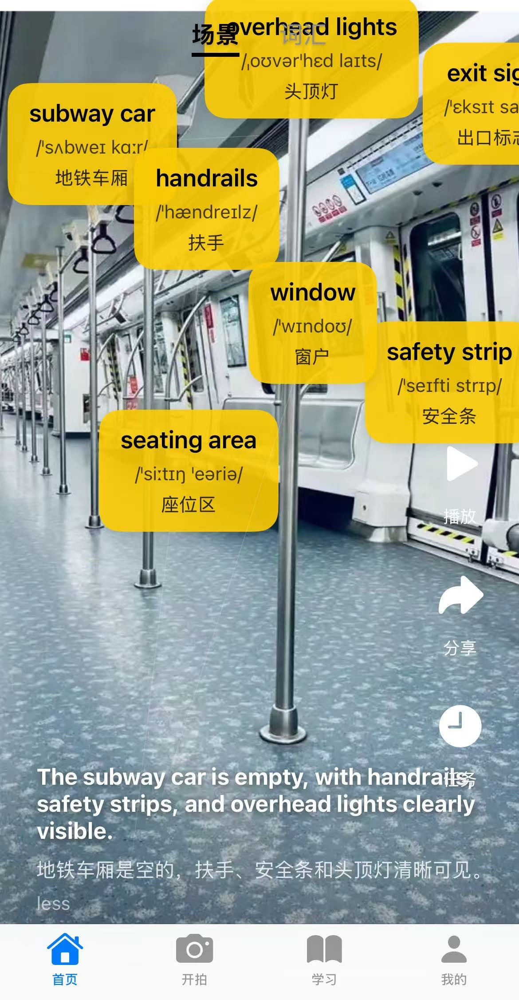
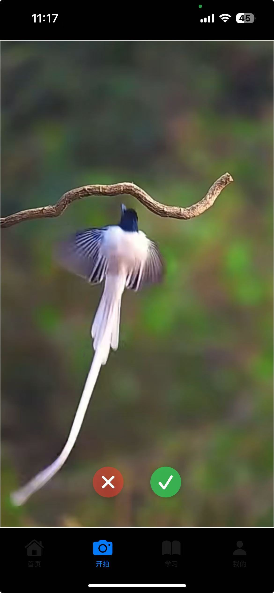
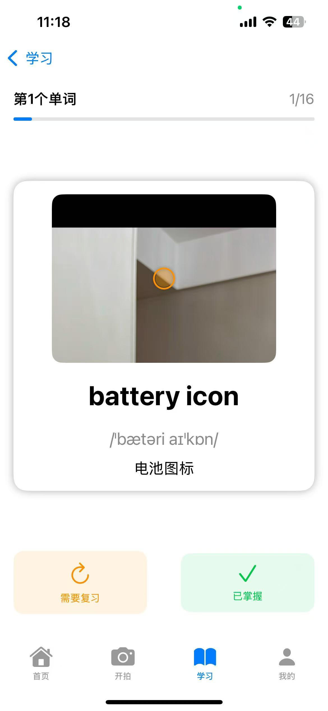
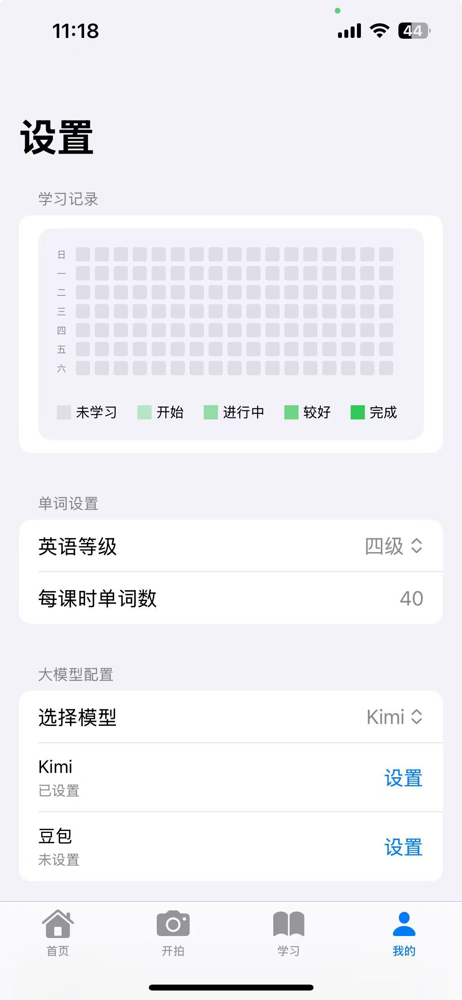

# PictureTalk

<p align="center">

<p>

PictureTalk（图语）是一款场景化英语学习 iOS 应用：拍照或从相册选图创建场景，AI 识别图中单词并标注位置，生成场景例句，配合学习计划与进度追踪。

[](https://swift.org)
[](https://www.apple.com/ios)
[](LICENSE)

## 功能

- **场景化学习** — 拍照/选图创建场景，AI 识别单词并标注位置，生成场景例句
- **智能分析** — 按英语水平推荐单词，提供音标、释义与发音
- **学习管理** — 自定义每日计划、进度追踪、收藏与复习
- **更多** — 场景分享、单词搜索、学习数据统计

## 产品截图

<div>
  
  
  
  
  
</div>

## 开始使用

- 系统要求：iOS 15.0+，iPhone 或 iPad
- 安装方式：当前仅支持源码编译

```bash
git clone https://github.com/nowszhao/PictureTalk.git
open PictureTalk/PictureTalk.xcodeproj   # 选择开发团队与 Bundle Identifier 后 Cmd+R
```

## 开发计划

- [ ] 接入更多 AI 模型
- [ ] 优化场景识别准确度
- [ ] 游戏化学习元素

## License

MIT
